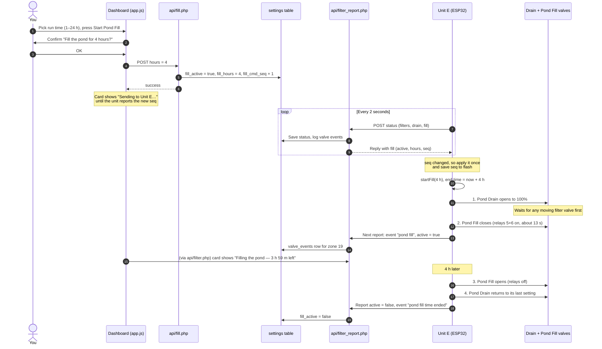

# Pond Fill — What Happens When You Press Start

Pond Fill is a normally open 2" valve on Unit E. While it is open, water from the Pond Drain goes to the tanks. A run opens the drain fully and then closes Pond Fill, so the water goes to the pond instead. When the run ends, both valves go back to how they were. Wiring and settings are in [filter-flush-unit.md](filter-flush-unit.md#pond-fill-web-page).

## From the Button to the Relays

## The Valves, Step by Step

|                | Before                  | Step 1                              | Step 2                | Running                        | Run ends                                                       |
|----------------|-------------------------|-------------------------------------|-----------------------|--------------------------------|----------------------------------------------------------------|
| **Pond Drain** | your setting (e.g. 30%) | opening → 100% (travel + 2 s margin) | 100% open            | 100% open, tank sensors ignored | back to your setting after Pond Fill opens (closed if tank full) |
| **Pond Fill**  | open (relays 5+6 off)   | open, waits for the drain           | closing (~13 s)       | closed                         | opens first (relays off)                                       |
| **Water goes to** | tanks                | tanks                               | switching             | pond                           | tanks                                                          |

## Ways a Run Ends

- **Time runs out:** the unit ends the run itself. It reports `active = false`, and the server clears `fill_active`.
- **Stop Pond Fill:** the server sets `fill_active = false` and bumps the seq. On its next report the unit opens Pond Fill, then moves the drain back.
- **Any Pond Drain button:** the page warns you first. It ends the fill: Pond Fill opens, then the drain goes to the position you pressed.
- **Unit E restarts:** with the relays off, Pond Fill opens and the drain closes. If the 12 V supply is lost, the valves stay where they are until it comes back. The saved seq stops the old command from running again.

## Rules the Unit Follows

- The 12 V 3 A supply runs only one 2" valve motor at a time, so the drain and Pond Fill never move together. Neither starts while a filter valve is moving.
- A filter flush cycle won't start while either 2" valve is moving.
- The Run time list and Start button are disabled while Unit E is offline or a command is still being sent.
- Every valve move is logged in `valve_events`: zone 18 for the Pond Drain, zone 19 for Pond Fill.
