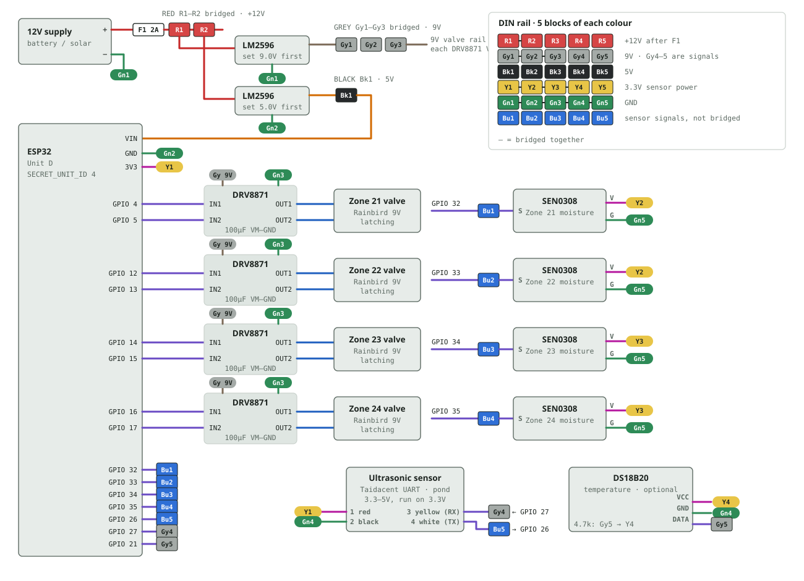

# Unit D — Zones 21–24 and Pond Level

Unit D is a zone unit like Units A–C, with four zones instead of five, plus an ultrasonic sensor that measures the pond level. It runs the same firmware as Units A–C (`firmware/irrigation_controller/`), built with `SECRET_UNIT_ID 4`.

The full wiring diagram, DIN rail map and build-and-test order are in [unit-d-wiring.html](unit-d-wiring.html) (open it in a browser).

## Parts

| Part | Use |
|---|---|
| ESP32 dev board | Controller |
| 4 × DRV8871 | One per zone, drives the valve |
| 4 × Rainbird 9V latching solenoid | Zone valves, same as Units A–C |
| 4 × DFRobot SEN0308 | Waterproof capacitive soil moisture sensor, one per zone |
| Taidacent waterproof ultrasonic sensor (UART) | Pond level, mounted above the water looking down |
| DS18B20 (optional) | Temperature, same as Units A–C |

## Pins

| GPIO | Connects to |
|---|---|
| 4 / 5 | Zone 21 DRV8871 IN1 / IN2 |
| 12 / 13 | Zone 22 DRV8871 IN1 / IN2 (12 is a strapping pin; the DRV8871 keeps it LOW at boot) |
| 14 / 15 | Zone 23 DRV8871 IN1 / IN2 |
| 16 / 17 | Zone 24 DRV8871 IN1 / IN2 |
| 32, 33, 34, 35 | SEN0308 signal for zones 21, 22, 23, 24 |
| 26 | Ultrasonic sensor pin 4, **white** (its TX) |
| 27 | Ultrasonic sensor pin 3, **yellow** (its RX) |
| 21 | DS18B20 data (4.7k pull-up to 3.3V) |
| 2 | On-board LED: solid = online, blinking = no WiFi |

All grounds go to one common ground, as on the other units.

## Sensors

**SEN0308 moisture sensors.** Power them from **3.3V**, so their output can never go above what the ESP32's inputs can take. They read high when dry and low when wet, like the A–C sensors. On 3.3V a SEN0308 gives about 2.2V in air (2600) and about 0V in water (0), so zones 21–24 are calibrated to 2600 dry, 0 wet (measured on Zone 21's sensor). Check each one in air and in a glass of water and update `sensor_calibration` if they differ. A sensor that loses power also reads 0, which shows as 100% wet, so if a zone suddenly reads 100% in dry weather, check its V wire.

**Ultrasonic sensor.** UART at 9600 baud. Each reading is 4 bytes: `0xFF`, high byte, low byte, checksum; the distance is high × 256 + low, in mm. The firmware takes the median of the last 15 readings to ride out ripples. It works with both versions of the sensor: the "auto output" one sends readings on its own, and the "controlled" one is asked for a reading whenever none arrive.

- Wires: pin 1 **red** = VCC, pin 2 **black** = ground, pin 3 **yellow** = RX (to GPIO 27), pin 4 **white** = TX (to GPIO 26).
- It runs on 3.3–5V. Power it from the ESP32's **3.3V**, so its TX signal is 3.3V and goes straight to GPIO 26. Don't power it from 5V without a divider on the white wire (10k from the white wire to GPIO 26, 20k from GPIO 26 to ground): a 5V signal can damage the ESP32 input.
- Mount it pointing straight down at open water, clear of the pond edge, plants and anything the beam could hit first. It can't read closer than about 25 cm, so leave at least that much between it and the highest the water ever gets.

## Pond level on the dashboard

- Unit D sends the distance to the water once a minute. The server stores **one reading every 30 minutes** in `pond_level_readings` for the graph.
- When the pond is where you want it, press **Set current level as normal** on the Pond Level card. The card, the graph and the Unit E pictorial then show the level as ▲/▼ inches above or below normal. You can set it again any time; the graph is recalculated from the stored distances.
- The graph shows 24 hours, 7 days or 30 days.

## Flashing

1. In `firmware/irrigation_controller/secrets.h`, set `SECRET_UNIT_ID` to **4**. The key for Unit D is already in that file and in `backend/config/device_keys.php`.
2. Unplug the board's power, connect USB and upload.
3. **Set `SECRET_UNIT_ID` back to 1** afterwards, so Unit A's next flash is right.

## Bring-up order

1. ESP32 alone: flash, check it comes online. The Unit D header on the dashboard shows its WiFi signal.
2. Ultrasonic sensor: the Pond Level card should show "Water is X in below the sensor". Hold a board at a measured distance below it to check the reading.
3. Moisture sensors one at a time: each zone card shows a moisture %.
4. DRV8871s and valves one zone at a time, as on Unit A: Open, then Close, from the dashboard.
